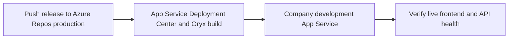
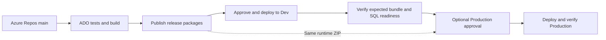

# Skill Management App deployment on Azure

## Current delivery path

As of 19 November 2026, Azure App Service `SSSkillmgmtAppWebAppDev` builds from the Azure Repos `production` branch using App Service Build Service. That path deployed `13508c2`. The public landing page, release frontend bundle and API health were verified. The operator reported applying SQL migration `115`. [Current company operations](CURRENT_OPERATIONS.md)

Azure Repos is the delivery remote. Keep the corresponding `main` and `production` refs aligned with the GitHub mirror after authorized promotions. The `production` branch in this setup targets the company **development** App Service.

## Single-build CI and CD

Point Azure Pipelines at root `/azure-pipelines.yml` from **Azure Repos Git**. CI runs on `main` with batching. In pipeline settings, use the YAML trigger. If an Azure Repos branch policy queues this pipeline for pull request validation, remove that pipeline from the build-validation policy during cutover. A PR merge-ref run skips the Build stage and provides no validation. [Azure Repos CI triggers and branch policies](https://learn.microsoft.com/en-us/azure/devops/pipelines/repos/azure-repos-git?view=azure-devops)

The workflow runs documentation, architecture, type, regression and desktop/mobile browser checks and publishes test and coverage reports. A successful `main` run publishes `skill-management-release` with the compiled Linux runtime ZIP, App Service source ZIP and ordered SQL migration ZIP. The runtime ZIP contains the built API and web files and locked production dependencies. [Pipeline configuration](../azure-pipelines.yml)

Once the Dev service connection is configured, approve the Dev deployment from the successful build's run page. The approval job runs without a build agent and expires after 24 hours. Batching holds subsequent push-triggered runs while an approval is pending. After approval, the deployment downloads that run's runtime ZIP and verifies the expected frontend bundle and `/api/ready`. Readiness requires a successful query through the app's runtime SQL identity. `/api/health` continues to report process liveness. [Manual validation in Azure Pipelines](https://learn.microsoft.com/en-us/azure/devops/pipelines/tasks/reference/manual-validation-v1?view=azure-pipelines)

### Cut over the Dev App Service

The Dev deployment stage is disabled by default. The existing Deployment Center path continues serving deployments until cutover.

1. Create an Azure Resource Manager service connection using workload identity federation, for example `skill-management-app-dev`. Scope access to the development App Service where feasible and authorize the delivery pipeline. [Microsoft service connection setup](https://learn.microsoft.com/en-us/azure/devops/pipelines/library/connect-to-azure?view=azure-devops)
2. Confirm the target resource group `SS_SkillMgmtApp_Dev`, App Service `SSSkillmgmtAppWebAppDev` and current source deployment settings. Set the `appServiceConnection` default to the authorized connection and confirm the resulting `main` run publishes its release and reaches the Dev approval.
3. During the cutover window, disconnect the Azure Repos source in Deployment Center and disable remote build by setting `SCM_DO_BUILD_DURING_DEPLOYMENT` and `ENABLE_ORYX_BUILD` to `false`. Keep the existing runtime identity, application startup and SQL/AI settings. [App Service ZIP deployment](https://learn.microsoft.com/en-us/azure/app-service/deploy-zip)
4. Apply any required SQL migration ZIP scripts separately before approving the existing run. Approve Dev on that run to deploy its package. Verify sign-in and representative employee, manager, Business Analytics and Admin workflows.

If the `production` branch still carries the old pipeline YAML, its next promotion must include the new YAML so it stops triggering its own CI.

### Enable Production when its environment is ready

Set `productionAppServiceConnection`, `productionResourceGroup`, `productionAppName` and `productionUrl` to the Production environment's values. The Production stage becomes available after successful Dev deployment in the same run and waits for its own manual approval. Configure the Production App Service for ready-to-run ZIP deployment before approving it. Both stages use the same archive. [Shared deployment jobs](../deploy-appservice.yml)

If cutover fails, keep traffic on the last verified release where available. Restore the previous reviewed source-deployment configuration or redeploy the last known good package through the active delivery path. Check application/schema compatibility before rolling back a release. [Azure migration and rollback runbook](AZURE_MIGRATION_RUNBOOK.md)
