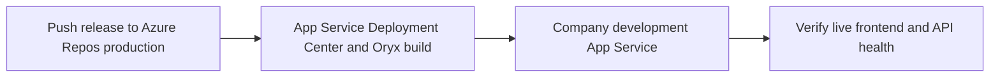
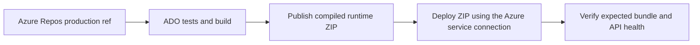

# Skill Management App deployment on Azure

## Current delivery path

As of 19 November 2026, Azure App Service `SSSkillmgmtAppWebAppDev` builds from the Azure Repos `production` branch using App Service Build Service. That path deployed `13508c2`. The public landing page, release frontend bundle and API health were verified. The operator reported applying SQL migration `115`. [Current company operations](CURRENT_OPERATIONS.md)

Azure Repos is the delivery remote. Keep the corresponding `main` and `production` refs aligned with the GitHub mirror after authorized promotions. The `production` branch in this setup targets the company **development** App Service.

## CI and planned pipeline cutover

Point Azure Pipelines at root `/azure-pipelines.yml` from **Azure Repos Git**. CI validates branch builds, and Azure Repos can use this pipeline as the `main` pull request build-validation policy. The workflow runs documentation, architecture, type, regression and browser checks and reports coverage. Successful `main` runs publish the source App Service ZIP and ordered migration ZIP in `skill-management-release`.

The direct-deploy configuration is on `main`. It checks `production`, packages the compiled API and web files with locked production dependencies, then deploys the same ZIP to the company development App Service. The Azure Pipelines parameter `appServiceConnection` currently defaults to `disabled`. The service connection has yet to be created. [Pipeline configuration](../azure-pipelines.yml)

1. In the Azure DevOps project, create an Azure Resource Manager service connection using workload identity federation. Suggested name `skill-management-app-dev`. Scope access to the development App Service where feasible and authorize only the delivery pipeline. Use the vendor guidance for the role and identity prerequisites for your tenant. [Microsoft service connection setup](https://learn.microsoft.com/en-us/azure/devops/pipelines/library/connect-to-azure?view=azure-devops)
2. Confirm the target resource group `SS_SkillMgmtApp_Dev`, App Service `SSSkillmgmtAppWebAppDev` and current source deployment settings. In the maintenance window, disconnect the Azure Repos source in Deployment Center and turn off App Service remote build. Keep the existing runtime identity, application startup and SQL/AI settings.
3. Set `appServiceConnection` in the pipeline to the authorized connection name and promote the reviewed pipeline change. Verify the package and deploy jobs finish on a `production` run. The deployed ZIP must serve the exact bundled frontend and a healthy API.
4. Apply matching SQL migrations separately on the target database before promoting a release that depends on them. Verify sign-in and representative employee, manager, Business Analytics and Admin workflows after cutover. Use isolated data for destructive and negative test cases.

If cutover fails, keep traffic on the last verified release where available. Restore the previous reviewed source-deployment configuration or redeploy the last known good package through the active delivery path. Check application/schema compatibility before rolling back a release. [Azure migration and rollback runbook](AZURE_MIGRATION_RUNBOOK.md)
