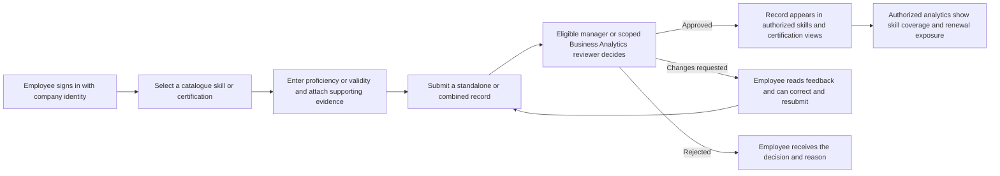

# Skill Management App operating workflow

Leadership briefing prepared on 20 November 2026. The app gives authorized leaders a view of recorded skills, certifications and renewal exposure within their remit. **Skill Genie** is the AI assistant inside the app. The current release runs in company development. The proposed pilot evaluates usefulness, process quality and access boundaries before broader rollout. [Current operations](CURRENT_OPERATIONS.md)

## Employee-to-analytics flow

| Participant                          | Responsibility                                                                                                                                                |
| ------------------------------------ | ------------------------------------------------------------------------------------------------------------------------------------------------------------- |
| Employee                             | Maintain own skill and certification records, attach supporting evidence, and follow decisions and renewals.                                                  |
| Assigned current manager             | Review eligible direct-report records against evidence and record the outcome.                                                                                |
| Eligible Business Analytics reviewer | Decide eligible records within the assigned organization scope and issuer coverage. Confirm coverage of every certificate before deciding a mixed submission. |
| Admin                                | Maintain governed access, organization and reporting data. App administration and review authority are assigned through their respective rules.               |
| HR and delivery leadership           | Use authorized views to identify coverage gaps and upcoming renewals, then agree a response with accountable owners.                                          |

The first eligible saved decision closes the pending submission. Approval comments are optional. Reject and Request changes require a reason. The application rechecks reviewer eligibility, scope, state and revision at decision time. [Approved access baseline](ACCESS_MODEL_REDESIGN.md)

## Communications and assistance

An authorized publisher chooses an eligible audience and reviews the preview before publishing an announcement. The publisher can attach an image popup with a single call to action, or configure a form or poll. Recipients can reopen an active announcement from notifications. Response access and export follow the publisher's assigned scope.

Skill Genie gives workflow guidance and prepares drafts for supported actions. Employees and reviewers confirm changes through the app's authenticated workflow. Learn & Grow and Requests & Incidents are reserved for a later phase. [Project handover](HANDOVER.md)

## Leadership demonstration

1. Sign in with a synthetic or approved pilot employee. Submit a catalogue skill and linked certificate with evidence in a combined record.
2. Open the assigned reviewer queue. Show the evidence and the outcome, including the comment requirement on a return or rejection.
3. Open an authorized analytics view. Show skill coverage and certificate renewals for the selected scope.
4. Open a scoped announcement from a recipient notification. Ask Skill Genie how to complete an available task.

## Proposed pilot measures

| Measure                 | Definition                                                                                                                 |
| ----------------------- | -------------------------------------------------------------------------------------------------------------------------- |
| Employee participation  | Invited employees who submit at least one record divided by eligible invitees.                                             |
| Decision turnaround     | Median elapsed time between submission and the first saved decision, with open volume reported separately.                 |
| Priority skill coverage | In-scope employees with an approved claim at the agreed level divided by employees in the agreed scope.                    |
| Renewal exposure        | Count of in-scope current certificates expiring in the next 90 days, broken down by accountable owner where access allows. |

Proposed decision for leadership is to nominate an HR sponsor and one pilot scope. HR and delivery owners can agree priority skills, reviewers, a baseline and a review date before invitations go out. IT validates hosted access scenarios and confirms the approved release path. The group uses pilot evidence to decide whether to expand.
